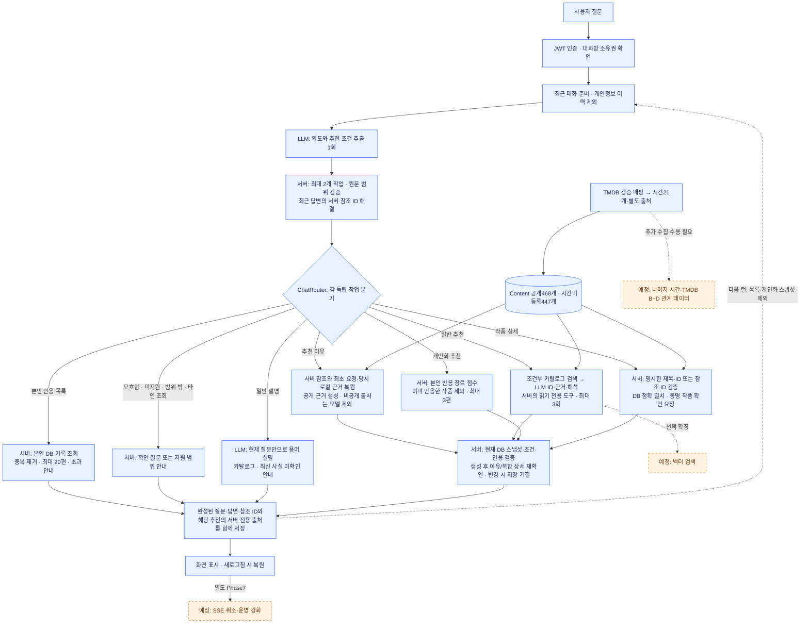

# AI 채팅 아키텍처 — 2026-11-24 마감

현재 확장: 분류의 `constraints` → 허용된 조건/사용자 원문 출처 검증 → SQL·도구·최종 재조회에서 동일한 사실 조건 적용. 분위기/감상 상황은 공개 근거와 모델 해석을 구분하고, 참조 범위/반복 제외는 서버 ID만 사용한다. nullable 영화 전체/TV 대표 회당 길이를 사용하며 기존468개 중 영화20개/TV1개에 검증된 시간과 별도 출처를 적용했다. 447개는 미등록이고 추가 보강이 필요하다. 최신 범위와 한계는 [AI_CONSTRAINTS.md](AI_CONSTRAINTS.md)를 참고한다.

최초 일반 추천은 기존 도구 선택 호출에서 `recommendations[{contentId,evidence,interpretation}]`을 함께 받으며 서버가 현재 Content의 원문 인용을 재검증해 근거/모델 해석을 구분해 렌더링한다. 명시적 겨울 조건은 최초 SQL·검색/상세 도구·최종 재조회 전체에서 유지한다. 부적합 후보를 일반 인기작으로 채우지 않는다. 기존 개인화 점수는 로컬 처리하며 반응을 조회한 턴의 자유 해석은 저장하지 않는다. 실제 모델 추가 3/3 검증과 범위는 [AI_RECOMMENDATION_QUALITY.md](AI_RECOMMENDATION_QUALITY.md)를 참고한다.

2026-11-18 추가: 추천 이유 후속 질문은 `RATIONALE` → 서버 참조 ID/해당 턴 질문 → 공개 카탈로그 1~5편 재조회 → 한 번의 원문 근거 JSON 생성/작품별 검증·해석 구분 → 기존 원자적 저장으로 처리한다. 여러 편 추천 뒤 일반적인 “이 영화 추천 이유”는 전체 목록을 설명하고 특정 순서는 한 편을 선택한다. 분류와 일괄 생성은 같은 턴 예산을 공유한다. 재발 사례를 포함한 실제 모델 합성 9/9 검증 및 한계는 [AI_RATIONALE.md](AI_RATIONALE.md)를 참고한다. 아래 57/61은 수정 전 분류기 측정값이다.

최신 현황: 분류/복합 스키마·명시적 확인 사유,서버 전용 추천 출처와 반복 이유,생성 후 DB 스냅샷 재조회가 구현됐다. 과거 실제 모델 측정은 원본59/61·수정 정책61/61,저장 대화28/28,개인화4/4,시간8/8이다. 실제 MySQL/JWT/HTTP/React는 합성 계정/고정 AI로 별도 수용했다. 이번 회귀와 각 평가의 시점·한계는 [최종 인계](AI_QUALITY_CLOSURE_2026-11-24.md)를 따른다. Phase7은 시작하지 않았다. 아래 파란 노드는 구현된 경로,주황 점선 노드는 예정/미수용 확장이다. 초기57/61 등 과거 측정은 기존 결과 문서에 보존한다.

LLM은 **어떤 기능을 원하는지 해석**합니다. 서버가 **누구의 데이터를 읽을지, 어떤 기능을 실행할지, 어떤 결과를 저장할지** 결정합니다. 모델은 DB 연결이나 사용자 ID 선택 권한이 없습니다. JSON 형식을 검증할 수 있어도 의미 분류의 정확성을 보장할 수는 없으므로, 실제 모델 품질 검증은 별도로 필요합니다.

| 정보 / 처리 | LLM 접근 |
| --- | --- |
| 사용자 질문과 최대 12개의 최근 메시지, 합계 12,000자 | 기존 정책에 따라 전달. 사용자 작성 문장은 유지 |
| 서버가 작성한 이전 반응 목록 | 제목·ID·반응을 포함한 답변 전체를 중립 문구로 대체 |
| 개인화용 최근 반응 100건 / 최대 16개 장르 점수 | 서버에서만 처리 |
| 새 좋아요·싫어요·찜 목록 | 서버에서만 조회·답변·저장 |
| 일반 추천의 공개 카탈로그 후보 | 기존 추천 흐름으로 전달 |
| 작품 상세 | 현재 턴 조회 결과는 모델에 보내지 않고 DB 필드로 답변. 공개 답변은 이후 최근 대화에 포함될 수 있음 |
| 영화·시리즈 일반 설명 | 분류 뒤 현재 사용자 질문만 전달. 도구·프로필·카탈로그·이전 대화 없음 |
| 일반 추천 도구의 본인 반응 | 기존 승인 범위: 그 턴에 반환된 최대 12개 작품의 상태 |

예: **“내가 별로라고 표시한 영화 보여줘”** → LLM이 `LIST_DISLIKE / MOVIE`로 해석 → 서버가 로그인한 본인의 DISLIKE 영화만 조회 → 실제 제목과 ID 표시 → 두 메시지 함께 저장. 다음 질문에서 LLM에는 목록 속 제목과 ID를 다시 보내지 않습니다.

예: **“싫어요를 반영해서 추천해줘”** → `PERSONALIZED / ANY` → 기존 서버 장르 점수로 최대 3편 선정. 개인화 계산은 로컬이지만 의도 분류에는 LLM 호출 1회가 듭니다.

예: **“2010년 영화 인셉션 줄거리 알려줘”** → `DETAIL`과 현재 질문에 명시한 제목·유형·연도 → 서버가 바인딩된 조건으로 정확 일치 조회. 최대 6행으로 동명·초과 여부를 확인하고 최대 5개 ID 선택지를 표시합니다. 1행이면 저장된 전체 줄거리(스키마 최대 2,000자)·장르·공개일을 표시합니다. 없는 작품·누락 정보·출연진/감독/결말 해설은 지어내지 않습니다. Phase 6.3에서는 서버가 저장한 최근 답변의 작품 순서로 상세 참조를 해결하고, 최대 두 독립 요청 또는 두 작품의 저장 필드 비교를 처리합니다. 아래의 6.3 경계를 따릅니다.

예: **“누아르란 무엇이야?”** → `EXPLAIN` → 도구 없는 일반 설명 1회. `catalogGrounded=false`와 서버 안내 문구로 DB 사실과 구분합니다. 지식의 정확성은 프롬프트나 JSON 검증만으로 보장되지 않습니다.

공통 생성 예산 기본값은 20초·출력800토큰입니다. 분류는 남은 예산에서 min(256,남은토큰/3)을 예약하고 최대1024토큰까지만 사용합니다. 기본800에서는544토큰,전체2048에서는1024토큰이며 전체턴상한을 늘리지 않습니다. 나머지를 추천/이유/일반설명 호출과 공유합니다. 최대 제공자 요청 5회(분류 1 + 추천 4), 도구 3회이며 재시도는 없습니다. 상세 조회는 분류 1회, 일반 설명은 분류 포함 2회입니다. DB 쿼리 제한은 드라이버에 의존하고 저장 트랜잭션은 생성 제한 시간 밖입니다. 실패·시간 초과·잘못된 출력이면 불완전한 대화를 저장하지 않습니다.

주요 코드: `ConversationService`(소유권 확인 이후 실행·완료), `ChatRouter`(분기), `OpenAiClient`/`ChatPlan`/`ChatIntent`(분류·계획 검증·일반 설명), `TurnBudget`(공통 제한), `CatalogDetails`(작품 상세), `ChatInteractionReader`(목록), `CatalogRecommendations`(추천), `ChatHistoryStore`(저장·문맥 개인정보 제외).

## Phase 6.3: 참조와 복합 요청

`classify` → `ChatPlan(requests[1..2], comparison)` → 원문 부분 문자열·조합 검증 → 서버 참조 슬롯 해결 → 상세 사전 조회 → 각 작업 실행 → 기존 `complete` 트랜잭션으로 사용자/답변/참조 ID 함께 저장.

서버 전용 `content_references`는 새 추천/상세 응답에서 검증한 공개 ID를 최대 5개 순서대로 저장합니다. HTTP 응답에는 포함하지 않습니다. 참조는 최근 assistant 턴 번호(1~6)와 작품 순서(1~5, 단일 작품이면 0도 가능)만 모델이 지정하며, 실제 ID는 소유권을 확인한 서버 문맥에서 가져와 DB를 재조회합니다. 텍스트의 ID·모델 지식은 참조 근거가 아닙니다. 기존 메타데이터 없는 기록, 비공개 목록, 모호하거나 창 밖의 참조는 제목/ID를 요청합니다.

독립 요청은 원문을 순서대로 겹치지 않게 나누며 공백 이외의 문자를 누락할 수 없습니다. 단일/비교 계획은 question=null이면 서버가 전체 질문을 사용하므로 긴 질문을 출력 토큰으로 복제하지 않습니다. 비교는 두 DETAIL과 전체 질문을 사용하고 저장된 사실을 병렬 표시합니다. 상세가 없거나 중복이면 나머지 작업을 중단하고, 동일 작품 비교는 확인 질문을 합니다. 생성 경로(RECOMMEND/PERSONALIZED/EXPLAIN/RATIONALE)는 최대 하나,provider 호출은 최대5회이며 분류의 동적 상한도 기존 턴 예산에 포함됩니다. 복합 결과는 완성된 뒤 한 턴으로 저장하고 실패 시 일부를 저장하지 않습니다.

반응 목록을 포함한 복합 답변은 전체를 기존 비공개 목록 접두어로 감싸서 후속 모델 문맥에서 제거하고 참조 슬롯도 비웁니다. 앞 목록 결과를 필터로 쓰는 종속 추천, 작품 유사도 필터, 두 개를 넘는 요청과 해석적 비교는 아직 확인 질문 대상입니다. JSON/부분 문자열 검증은 의미 분류의 정확성을 보장하지 않으며, 다양한 표현에 대한 실모델 품질 평가는 Phase 6.4 범위입니다. nullable 컬럼의 MySQL 자동 추가/수동 대안은 AI_SETUP.md에 기록했습니다.

## 추천 출처·최신성의 추가 경계

`recommendation_provenance`는 nullable 서버 전용 JSON으로 최초 요청과 당시 로컬 개인화 근거를 보존한다. 소유권 확인 후 서버 맵으로만 준비하며 공개 JSON/AiMessage에 포함하지 않는다. 출처 없는 과거 기록은 개인화 근거를 추측해서 복원하지 않는다. [출처 보존](AI_RECOMMENDATION_PROVENANCE_2026-11-24.md).

최종 DB 조회는 OSIV 관리 객체 재사용을 피하는 생성자 스냅샷을 사용한다. 이유는 모델에 쓴 DTO필드,생성을 포함한 복합상세는 실제 표시본문을 재검증한다. 생성 중 변경이면502/턴저장0이며 최종조회 이후 커밋까지의 변경을 잠금보장하는 구조는 아니다. [최신성 검증](AI_CATALOG_FRESHNESS_2026-11-24.md).

주황 노드는 개발·운영 수용이 끝난 기능을 뜻하지 않는다. 실제사용자+제공자+MySQL/화면 동시수용,자유취향설명의품질,간결/스포일러,간헐503,추가메타데이터는 [마감의 잔여표](AI_QUALITY_CLOSURE_2026-11-24.md)를 따른다.
