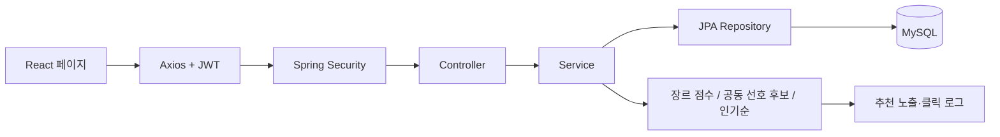
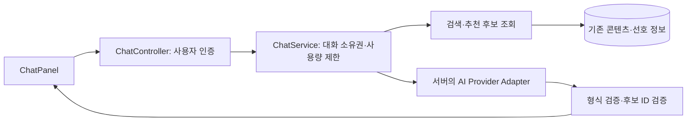

# 프로젝트 분석과 AI 기능 개발 준비

## 후속 수정 상태 — 2026-11-11

인증 기반 1차 수정을 적용했다. JWT 외부 키 주입·삭제 계정 거부·예외 범위 축소, 가입 응답 DTO, 공통 비밀번호 정책, 회원 서비스 400/403/404/409 구분, 프런트 401 전용 세션 만료, `.env` 제외를 완료했다. 테스트 기반을 복구해 백엔드 15개와 프런트 10개 테스트 및 프런트 빌드가 통과했다. 실제 DB 통합 기동은 검증하지 않았다.

**후속 작업에서 휴대폰 인증 방어 로직·프로필 업로드 검증과 추천 정확성 일부(협업 지지 수, 싫어요, 조회수 0)를 수정했다.** 추천 노출·클릭 통계도 후속 수정했고 H2 격리 DB 집계를 검증했다(누적 backend 48개/frontend 23개 테스트 및 프런트 빌드 통과). 실제 SMS 발송과 AI 채팅은 미완료다. 추천 통계 전환 전 exposed_at 컬럼/인덱스 및 프런트 동시 반영이 필요하다. 토큰 폐기는 후속 작업에서 구현했다(비밀번호 변경/로그아웃 시 모든 기기 폐기). 배포 전 token_version 컬럼 추가와 전체 재로그인이 필요하다. 비활성 사용자 상태는 아직 추가하지 않았다. 서버 실행에는 최소 32 UTF-8 바이트의 새 `JWT_SECRET` 환경변수가 필요하다. 상세 완료/미완료 범위는 [최신 작업 인계](next-chat-handoff.md)의 맨 위 절을 따른다. 아래 본문과 줄 번호는 수정 전 분석 기록이다.

분석일: 2026-11-11. 대상: recommend-backend, recommend-front의 현재 로컬 코드.
실제 운영 서버·DB 데이터·배포 설정은 검사하지 않았다. 구현 결함과 운영 조건에 따라 발생하는 위험을 구분했다. 애플리케이션 코드는 수정하지 않았다.

## 프로젝트 설명

영화·TV 콘텐츠를 사용자 취향과 행동에 따라 추천하는 웹 서비스다. 회원가입, JWT 로그인, 선호 장르 온보딩, 검색·상세 조회, 좋아요·싫어요·찜, 개인화 추천, 관리자 콘텐츠 관리와 추천 통계를 제공한다.

백엔드는 Java 17 / Spring Boot 4.0.0 / Spring Security / JPA / MySQL, 프런트엔드는 React 19 / React Router 7 / Axios / react-scripts 5를 사용한다. 추천은 장르 점수, 공동 선호 사용자 후보, 누적 조회수 fallback을 조합하는 자체 로직이다. 현재 LLM이나 외부 AI API를 사용하는 코드는 없다.

README의 Redis 휴대폰 인증, SMS, Swagger 설명은 구현 상태와 차이가 있다. Redis 컨테이너는 있지만 Redis 의존성·클라이언트 사용은 없으며 인증 코드는 MySQL 엔티티에 저장된다. SMS 발송 연동과 Swagger 문서 생성 의존성도 현재 pom.xml에서 확인되지 않는다. JWT_SECRET 예시는 실제 JwtUtil에 연결되지 않았다.

## 현재 구조

| 계층 | 역할 | 주요 파일 |
|---|---|---|
| backend/config | JWT, 인증·권한, CORS, 업로드 정적 경로 | JwtFilter, JwtUtil, SecurityConfig, WebConfig |
| backend/controller | 회원·콘텐츠·추천·행동 API와 DTO | UserController, ContentController, RecommendController, InteractionController |
| backend/service | 추천 계산과 회원·콘텐츠·행동 처리 | RecommendService, UserService, ContentService, InteractionService |
| backend/repository | JPA 조회, 검색, 추천 후보·통계 집계 | ContentRepository, UserContentInteractionRepository, RecommendLogRepository |
| backend/domain | 계정, 콘텐츠, 행동, 추천·클릭 로그, 인증·약관 | User, Content, UserContentInteraction 등 |
| backend/admin | 관리자 콘텐츠 CRUD와 통계 | AdminContentService, AdminRecommendService |
| front/src/api | Axios 설정과 API 호출 래퍼 | axiosInstance, contentApi, recommendApi 등 |
| front/src/components | 라우트별 페이지와 인증 가드 | HomePage, MyPage, AdminPage, ProtectedRoute |



추천의 cold start는 좋아요·찜이 없는 사용자에게 적용된다. 온보딩 장르가 있으면 장르 기반, 없으면 조회수 순이다. Warm start에서는 좋아요·찜·최근 클릭 장르로 점수를 만들고 일부 탐색 후보와 협업 후보를 섞는다. 조회 이력에는 감점을 준다. 탐색 20%는 warm start에서 전체 목록이 아닌 장르 기반 후보 묶음에 적용되므로 전체 추천의 정확한 20%가 아니다.

장점은 계층 구분, 서버의 ADMIN 접근 제어, BCrypt 사용, 가입 DTO, 필수 약관의 서버 검증, 클릭 로그 소유자 검사, 추천 이유·대체 추천·관리자 통계의 기본 틀이 있다는 것이다. 기존 추천 데이터를 AI에 연결할 기반이 있다.

## 우선 수정할 문제

아래 경로는 별도 표시가 없으면 backend의 src/main/java/com/example/recommend 기준이다. P0는 공개 운영 전 필수, P1은 정확성·핵심 기능, P2는 유지보수·확장 항목이다.

| 우선순위 | 근거 | 문제·영향 | 개선 |
|---|---|---|---|
| P0 | config/JwtUtil.java:15 | 서명 키가 코드에 고정돼 있다. 키를 아는 사람이 기존 사용자 이메일의 토큰을 위조할 수 있다. JWT_SECRET 설정은 사용되지 않는다. | 환경변수 또는 비밀 저장소 주입, 키 누락 시 시작 실패, 운영에 사용했다면 키 교체와 기존 토큰 무효화 |
| P0 | controller/PublicPhoneController.java:35 | 비로그인 API가 인증번호를 응답한다. SMS 소유 확인으로 사용할 수 없다. | 개발 인증과 운영 SMS 구현 분리, 운영 응답에서 코드 제거 |
| P1 | service/PhoneVerificationService.java:87, service/UserService.java:146 | 번호의 최근 인증 상태만 확인하고 가입 요청자와 연결하지 않는다. 인증 증명을 일회성으로 소비하지 않는다. | 요청 세션에 연결된 짧은 수명의 검증 티켓, 가입 시 원자적 소비, 발송·실패 횟수 제한, SecureRandom |
| P1 | controller/UserController.java:32, domain/User.java | 가입 응답이 User 엔티티여서 비밀번호 해시 등 내부 필드가 직렬화될 수 있다. | id/email/nickname만 담는 응답 DTO; 민감 필드 직렬화 방지 |
| P1 | config/JwtFilter.java:67 | DB에 없는 사용자도 USER 권한으로 인증된다. 삭제된 계정의 유효 토큰으로 인증 필요 콘텐츠 API에 접근할 수 있다. | 사용자가 없거나 비활성 상태이면 인증 거부 |
| P1 | config/JwtFilter.java:83 | filterChain까지 광범위한 catch(Exception)에 포함된다. 필터까지 전파된 애플리케이션 오류를 401로 바꿀 수 있다. | JWT 파싱 오류만 좁게 처리; 체인 호출 분리 |
| P1 | service/UserService.java:253 | 비밀번호 변경 시 가입 때의 길이·형식 검증이 없다. | 가입·변경 공통 정책 및 토큰 폐기 정책 |
| P1 | exception/GlobalExceptionHandler.java:12, front/src/api/axiosInstance.js:30 | 중복 닉네임 같은 IllegalStateException도 403, 프런트는 모든 403을 로그아웃 처리한다. 닉네임 중복만으로 세션이 지워질 수 있다. | 401만 재인증; 중복 409, 권한 403, 입력 400, 없는 자원 404를 분리 |
| P1 | controller/UserController.java:204, config/WebConfig.java | 업로드 경로가 Windows 고정이다. 파일 형식·실제 이미지 검증이 없고 확장자 없는 파일은 substring에서 실패한다. 공개 정적 경로에 임의 확장자를 저장한다. | 설정 가능한 저장소, 이미지 디코딩/재인코딩, 크기·픽셀·형식 제한, 컨테이너 볼륨 또는 오브젝트 저장소 |
| P1 | service/UserService.java:362, admin/service/AdminContentService.java:96 | 회원·콘텐츠를 직접 삭제하고 약관·행동 FK를 정리하지 않는다. JPA 생성 FK가 적용된 DB에서는 삭제가 제약 오류로 실패할 수 있다. | 트랜잭션으로 종속 데이터 정리 또는 soft delete; 로그 익명화·보존 정책 명시 |

공개 인증과 로그인 후 인증은 서로 다른 구현이다. 후자는 User에 인증번호를 저장하지만 실제 발송이 없어 UI만으로 완료할 수 없다. 공통 인증 서비스로 합쳐야 한다.

## 추천·분석의 정확성 문제

1. **협업 추천의 빈도 집계가 작동하지 않는다.** repository/UserContentInteractionRepository.java:60의 `select distinct u.content.id`가 후보별 중복을 제거한다. service/RecommendService.java의 collaborativeIds는 이 결과를 빈도로 세지만 모든 후보 빈도가 1이 된다. 예를 들어 유사 사용자 10명이 좋아한 A와 1명만 좋아한 B의 지지가 같아지고 조회수가 순위를 결정한다. DB에서 콘텐츠별 `count(distinct user_id)`를 집계하고, 필요하면 사용자 유사도 가중치를 추가한다.

2. **source 통계의 노출 분모가 JOIN으로 증가한다.** repository/RecommendLogRepository.java:190은 노출과 클릭을 1:N JOIN한 후 `count(rl.id)`를 쓴다. 노출 1개에 클릭 3개면 노출도 3개로 집계된다. `count(distinct rl.id)` 또는 사전 집계를 사용한다. 이 예의 unique CTR은 100%여야 하지만 현재는 약 33%가 된다.

3. **API 반환을 실제 노출로 기록한다.** RecommendService의 forYouWithReasons는 모든 반환 후보를 기록하지만 front/src/components/HomePage.js:214에서 20개를 요청하고 :225에서 12개만 표시한다. 화면에 보이지 않은 항목도 집계된다. 후보 생성과 노출 기록을 분리하고 화면 표시 기준 노출 이벤트를 idempotency key와 함께 전송한다.

4. **통계별 집계 기준이 다르다.** 노출은 24시간 user/content 단위로 재사용하지만 클릭은 매번 추가한다. 대시보드는 클릭 시각, source 통계는 노출 시각도 함께 제한하므로 기간 경계에서 결과가 달라진다. total clicks/impressions는 100%를 넘을 수 있다. 고유 노출 대비 클릭 여부와 반복 클릭 수를 별도 지표로 정의하고 동일한 노출 집합을 기준으로 집계한다. 기존 로그 재사용 시 이번 추천 source와 이전 source의 귀속도 달라질 수 있다.

5. **cold start 일부 경로가 싫어요를 무시한다.** RecommendService.java:298의 온보딩 장르 없는 인기순 분기는 disliked/exclude 필터가 없다. 좋아요·찜 없이 싫어요만 남긴 사용자는 해당 콘텐츠를 다시 받는다. 모든 추천·fallback 경로에 공통 제외 정책을 적용한다.

6. **조회수가 모두 0이면 NaN 점수가 나온다.** RecommendService.java:327, :438에서 maxView가 0이어도 나눈다. `orElse(1L)`는 값이 없는 경우만 처리한다. 신규 카탈로그처럼 모든 조회수가 0이면 장르 점수 후보가 필터링되고 인기순 fallback으로 내려갈 수 있다. 분모를 최소 1로 보정한다.

7. **매 요청 전체 카탈로그를 읽는다.** RecommendService.java:290와 :622가 전체 콘텐츠를 읽고 Java에서 정렬한다. Warm start에서는 중복 전체 조회도 발생한다. DB 후보 조회와 제한, 후보 맵 재사용, 사용자 선호 요약·캐시를 적용한다. 데이터 규모와 응답시간은 측정 전이므로 현재 장애라고 단정하지 않는다.

8. **행동 상태와 이벤트가 한 테이블에 섞여 있다.** LIKE/DISLIKE/BOOKMARK는 조회 후 삽입이라 동시 요청 시 중복될 수 있고 DB unique 제약이 없다. 조회수도 read-modify-write라 증가분 유실 위험이 있다. VIEW 이벤트와 유일한 사용자 상태를 분리하고 상태 unique 제약, 원자적 조회수 증가, 명시적 찜 설정/해제 API를 사용한다. VIEW까지 단순 복합 unique를 걸면 정상 반복 조회를 막으므로 주의한다.

9. **‘인기 급상승’은 누적 조회수 순이다.** 최근 기간의 상승량 계산이 없다. 현재는 인기순으로 표시하거나 최근 24시간/7일 이벤트를 집계한다. 사용자별 평점 입력도 없고 현재 평점은 콘텐츠 메타데이터다.

추천 품질 향상을 위해서는 싫어요 장르 감점, 최근 행동 시간 감쇠, 인기 편향 완화, 전체 추천의 다양성, 기존 추천과 AI 추천의 동일 기준 비교가 필요하다. 이들은 버그 수정과 구분할 제품 개선이다.

## 구조·프런트엔드·배포 개선

- HomePage 702줄, MyPage 634줄, AdminPage 920줄에 API 요청·상태·모달·화면이 함께 있다. 페이지는 조립 역할로 두고 콘텐츠 카드/상세 모달/온보딩/관리자 통계/편집 폼과 조회 hook을 분리한다. 새 채팅을 HomePage 안에 직접 추가하지 않는다.
- API 래퍼가 있지만 페이지에서 Axios를 직접 호출하고 authApi/userApi에 휴대폰 API가 중복된다. 인증 컨텍스트와 API 계층을 통일한다.
- HomePage의 Promise.all 중 한 요청이 실패하면 모든 목록을 비운다. 영역별 로딩·오류·재시도를 제공한다. 클릭·상세 오류를 빈 catch로 숨기는 부분도 사용자 피드백과 진단 로그를 분리한다.
- LIKE/DISLIKE 버튼은 toggle이라는 프런트 함수명과 달리 백엔드에서 반복 클릭해도 해제되지 않는다. 해제를 허용할지 제품 정책과 API를 맞춘다. 찜은 가능하지만 내 찜 목록을 조회·관리하는 전용 API와 화면은 없다.
- MyPage.js:9의 이미지 API 주소는 localhost로 고정되어 axiosInstance의 환경 설정을 따르지 않는다. 배포 시 사용자 PC의 localhost로 이미지 요청이 간다.
- 요청 size/page/days의 상한, 콘텐츠 평점·카운트 범위, 문자열 길이, 선호 장르 허용 목록을 서버에서 검증한다. 현재 추천 size 음수는 예외를 만들며 큰 값은 부담을 늘린다.
- DTO 위치가 controller/dto, dto/user, admin/dto, 내부 record로 섞인다. 응답 DTO·오류 스키마·URL 접두사(`/api/v1`)를 점진적으로 통일한다. 엔티티의 API 직접 반환을 줄인다.
- 장르 CSV는 부분 문자열 검색과 표기 흔들림을 만든다. 장르 식별자 및 관계 테이블로 정규화하고 기존 데이터 변환을 준비한다.
- application.properties의 DB 접속 값과 ddl-auto=update는 개발/운영 프로필로 분리하고 버전 관리 마이그레이션을 도입한다. .env는 현재 미추적 상태지만 .gitignore에서 제외되지 않는다. .env 제외와 .env.example 관리를 먼저 정리한다. 분석 과정에서 .env 값은 읽지 않았다.
- CORS가 SecurityConfig/WebConfig에 중복되고 localhost만 허용한다. 단일 설정으로 통합한다. Docker에는 DB healthcheck와 이미지 파일 영속 볼륨이 없다. 루트의 중복 RecommendApplication.java는 Maven src 밖의 낡은 클래스다.
- 프런트 README는 기본 CRA 안내이며 백엔드 README도 실제 구현과 불일치한다. 실제 실행 방법, 환경변수, seed 데이터, 관리자 계정 준비, API 계약, 기능의 개발/운영 상태를 문서화한다.

## 확인한 실행 결과

- 백엔드: `mvnw.cmd test` 실행. 메인 51개 소스 및 테스트 컴파일 후 테스트 1개가 설정 탐색 오류로 실패한다. 테스트는 com.example.demo, 실제 앱은 com.example.recommend에 있어 @SpringBootConfiguration을 찾지 못한다. 패키지 정리 또는 명시적 classes 지정 후 별도 테스트 DB를 구성해야 한다. 현재 결과는 서버 기동·DB 쿼리 성공을 보장하지 않는다.
- 프런트 테스트: `npm.cmd test -- --watchAll=false --runInBand` 실행. Jest가 App.js의 react-router-dom 모듈을 해석하지 못해 테스트 0개 실행 상태에서 실패한다. 의존성 설치 상태와 Jest/package exports 호환 설정을 조사해야 한다. 기존 App.test.js의 learn react 링크 검증도 현재 UI와 불일치한다.
- 프런트 프로덕션 빌드: `npm.cmd run build` 성공. Browserslist 데이터가 오래되었다는 경고가 있다. 번들 생성 성공은 브라우저 동작·API 연동 성공을 보장하지 않는다. 빌드는 성공하므로 테스트의 모듈 해석 오류를 곧바로 애플리케이션 의존성 전체 누락으로 단정하지 않는다.
- 브라우저 E2E, 실제 DB 삭제·동시성 재현, 운영 취약점 공격, 외부 유료 AI 호출은 수행하지 않았다. 위 코드 결함 중 운영 DB 의존 항목은 재현 조건을 별도로 명시했다.

## AI 기능 방향

사용자가 말한 open api는 외부 공개 API 연동으로 해석한다. OpenAI는 선택 가능한 공급자 예시이며 공급자·모델·요금제는 확정하지 않는다.

첫 기능으로 대화형 콘텐츠 추천을 제안한다. “오늘은 가벼운 코미디가 좋아”, “방금 추천한 작품보다 덜 무서운 걸로”, “내가 찜한 작품과 비슷한 것 3개” 같은 요청에서 대화 맥락과 기존 선호 정보를 함께 사용한다. 이미 있는 추천·검색·찜을 하나의 사용자 흐름으로 연결할 수 있다.

현재 Content에는 제목·소개·장르·공개일·평점 등이 있지만 상영시간, 연령등급, OTT 제공처, 상세 분위기 태그는 없다. “90분 이하”, “어린이와 시청”, “특정 OTT에서 시청” 같은 조건은 데이터 보강 전에는 정확히 보장할 수 없다. LLM이 이런 필드를 지어내지 않도록 지원 조건과 모르는 정보를 구분해야 한다.



### MVP 범위

1. 먼저 메시지 + 선호 요약 + 제한된 DB 후보를 서버에서 구성한다. 자연어 조건은 검증 가능한 검색 조건으로 변환하고, 필요한 경우 한정된 읽기 도구만 호출한다.
2. AI에는 contentId, 제목, 장르, 소개 등 필요한 필드만 제공한다. 이름·전화번호·생년월일·비밀번호·JWT를 보내지 않는다.
3. 응답은 message와 recommendations[{contentId, reason}]로 구성한다. 서버는 추천 ID가 이번 후보 집합에 있는지, 제외 조건을 지키는지 재검증하고 제목·이미지·평점은 DB에서 채운다. 형식 검증만으로 사실성이 보장되지는 않는다.
4. 후보가 없으면 추가 조건을 질문하거나 결과 없음을 표시한다. 공급자 장애 시 기존 추천을 표시하면서 AI 응답 실패를 알린다.
5. 처음에는 일반 JSON 응답으로 완성하고 다음 단계에 스트리밍을 추가한다. 기존 Bearer 인증을 유지한다면 Authorization 헤더를 실을 수 있는 fetch 스트림 등을 검토한다.

OpenAI를 선택할 경우 Responses API의 function calling으로 서버 검색 기능을 연결하고 Structured Outputs로 응답 형식을 제한할 수 있다. 도구 실행과 사용자 권한 검사는 서버 책임으로 둔다. 공식 근거: [Function calling](https://developers.openai.com/api/docs/guides/function-calling), [Structured Outputs](https://developers.openai.com/api/docs/guides/structured-outputs).

### 제안 코드 구성과 API 계약

현재 모놀리스 안에 chat 기능 패키지를 추가하는 것으로 시작한다. 별도 Python 서버나 벡터 DB는 실제 검색 품질 요구가 확인될 때 도입한다.

```text
backend/chat/
  controller/ChatController
  dto/ChatMessageRequest, ChatMessageResponse
  service/ChatService, ChatContextBuilder
  provider/AiChatClient, 공급자별 Adapter
  domain/ChatConversation, ChatMessage, AiUsageLog
  repository/...
front/src/features/chat/
  ChatPanel.js, MessageList.js, ChatComposer.js
  RecommendationMessage.js, useChat.js, chatApi.js
```

| 제안 API | 용도 |
|---|---|
| POST /api/v1/chat/conversations | 내 대화 생성 |
| POST /api/v1/chat/conversations/{id}/messages | 메시지 전송; message, clientRequestId |
| GET /api/v1/chat/conversations/{id}/messages?cursor=... | 내 대화 기록 페이징 |
| DELETE /api/v1/chat/conversations/{id} | 내 대화 삭제 |

소유자는 요청 body의 userId가 아닌 인증 정보로 결정한다. 대화 ID를 안다고 접근할 수 없도록 조회·쓰기·삭제 모두 소유권을 확인한다. clientRequestId에 사용자/대화 범위 unique 제약을 두어 재전송의 중복 저장·과금을 제어하고, 동시 메시지의 순서와 실패 상태도 관리한다.

최소 저장 정보는 대화의 userId·생성/갱신 시각, 메시지의 role·내용·상태·순서·clientRequestId, 사용량의 공급자·모델·토큰·지연·실패 코드다. 사용자 제공 role/system 지시를 그대로 권한 있는 메시지로 사용하지 않는다. 대화 보존 기간과 삭제 동작을 명시한다.

외부 호출은 긴 DB 트랜잭션 밖에서 수행한다. 먼저 짧은 트랜잭션으로 요청을 기록하고 외부 호출 후 짧은 트랜잭션으로 결과를 저장한다. 서버 비밀키, 연결/응답 시간제한, 사용자별 요청·토큰·동시 실행 상한, 공급자 호출 횟수 상한, 제한된 재시도, 사용량 기록을 함께 구현한다. 키는 REACT_APP_*에 넣지 않는다. 문서·소개글·사용자 메시지는 비신뢰 데이터로 취급하고 모델에 임의 SQL·URL 요청·관리자 쓰기 권한을 제공하지 않는다.

## 실행 순서와 완료 기준

| 단계 | 작업 | 완료 기준 |
|---|---|---|
| 1. 안전한 기반 | JWT 키, 인증 응답, 가입 DTO, 사용자 존재 검사, 401/403, 비밀번호 정책 | 위조/만료/삭제 사용자 토큰 거부; 중복 닉네임에 로그아웃하지 않음 |
| 2. 추천 정확성 | 협업 집계, CTR JOIN, 노출 기록, cold start, 0 조회수 | 유사 사용자 10명/1명 차이 반영; 노출 1·클릭 3 데이터 정확 집계; 싫어요 제외 |
| 3. 회귀 검증·환경 | 테스트 복구, 테스트 DB, 마이그레이션, README/환경 정리 | 서버 테스트와 프런트 테스트·빌드 통과; 깨끗한 환경에서 재현 가능 |
| 4. 채팅 MVP | 독립 ChatPanel, 서버 어댑터, 기존 후보 기반 응답, 대화 소유권·사용량 제어 | 실제 존재하는 콘텐츠만 추천; 타인 대화 접근 거부; 재전송 중복 방지; 공급자 실패 대응 |
| 5. 품질 개선 | 스트리밍, 대화 요약, 후보 검색 개선, 필요 시 임베딩 | 고정 평가 질문에 대해 정확성·응답시간·요청당 비용을 기준선과 비교 |

우선 회귀 시나리오는 인증·권한, 가입 응답 민감 필드, 비밀번호 변경, FK 삭제 정책, 찜 동시 요청, 0 조회수 추천, 싫어요만 있는 사용자, source 집계다. AI는 공급자 mock으로 소유권·비용 제한·잘못된 ID·시간초과·중복 요청을 검증하고, 허가된 소규모 실호출로 한국어 품질과 비용을 측정한다.

AI 다음의 외부 API 기능으로는 콘텐츠 메타데이터 가져오기와 중복 갱신 작업이 유용하다. 공급자 외부 ID와 수집 시각을 저장하고 관리자 검토 후 반영하는 흐름을 제안한다. 특정 공급자의 사용 조건·가격·이미지 표시 규칙은 공급자 선정 단계에서 별도 확인해야 한다.
